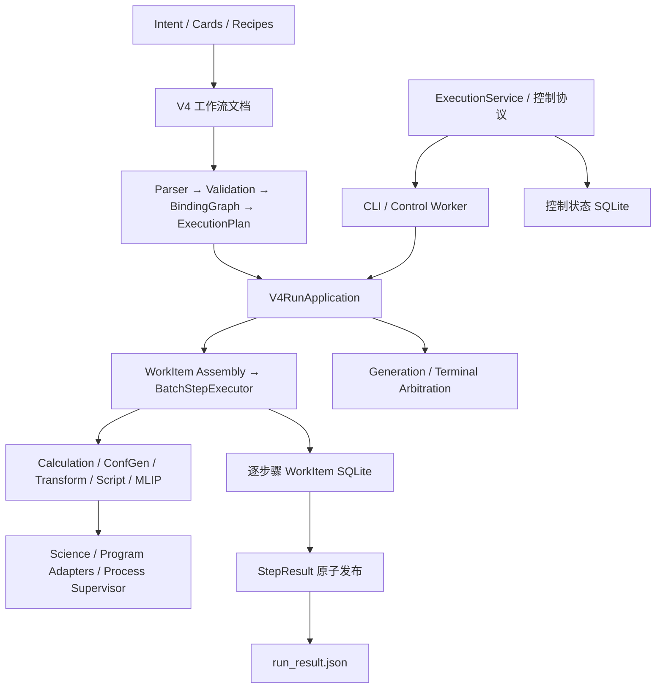

**ConfFlow 架构评审 — 2026-10-28**

评审基线：`6aa2459280701320c5a25e8b82f9dbeef8ea30c5`，版本 `2.1.6`，包含评审开始时工作区内的未跟踪实验文件。此次只新增评审报告，没有修改生产代码、现有测试或用户实验文件。

结论：保留现有模块化单体架构。领域模型、显式数据流、结果发布和恢复协议值得保留；近期优先工作应是补齐各执行器共同遵守的科学参数与执行身份契约。当前最重要的风险是：某些结果能够被成功发布，却没有对应到实际执行的模型、脚本或电荷/自旋设置。继续增加执行器之前，应先修复下面四项 P1。

这里的 P1 指影响科学结果正确性或可追溯性的已复现问题；P2 指已经确认的边界缺陷或扩展性/部署风险。没有把所有大文件、串行调度或历史兼容代码都当成缺陷。

**实际架构与规模**

上述图描述主数据流，不代表严格单向的 Python 包依赖。实际源码存在 `workflow ↔ execution` 的包级依赖、`execution → persistence` 的具体实现依赖，以及根包加载科学依赖的副作用。延迟导入避免了部分导入时循环，但并未消除概念耦合。

| 项目 | 本次实测 |
| --- | ---: |
| 生产 Python 模块 | 197 |
| 生产物理行数 | 69,843 |
| 固定 V4 入口静态可达模块 / 行数 | 179 / 66,404 |
| 其他入口或静态不可达行数 | 3,439 |
| 超过 1,000 行的生产模块 | 11 |
| 测试文件 | 230 |

“静态不可达”不等于死代码；度量包含可解析的函数内导入，不能覆盖所有动态导入。源码依赖图中发现 `confgen_executor ↔ confgen_search_run` 的两模块环；不能据此声称项目存在大规模运行时循环导入。

**应保留的设计**

- `domain` 用不可变记录、明确的结构/结果身份、单位和 JCS 规范化表达科学语义，避免把文件名和位置当作身份。
- V4 明确区分解析、语义校验、绑定图、执行计划与运行时组装；绑定端口和完成策略比隐式任务流水线可靠。
- 工作流定义、步骤语义、work item、执行环境四条摘要轴的设计是合理的。问题集中在部分执行器漏接这些轴。
- WorkItem 存储、StepResult 和 RunState 有明确的事实与投影关系；发布包含文件同步、原子替换、generation fencing 和终态仲裁。保留这些不变量比简单合并所有状态文件更重要。
- `science/confgen` 通过 `Calculator` 和注入的并行映射与进程/I/O 分离，显式种子、搜索预算、拓扑与立体化学审计有相应测试。
- Producer 生成面向消费者的配置/authoring/结果契约，并有独立的 JobDesk 契约流水线，方向正确。

**R1 · P1：省略 execution 配置时，实际进程环境不进入复用身份（已复现）**

位置：[v4_run.py:819](/opt/ConfFlow/confflow/application/v4_run.py:819)、[script_executor.py:260](/opt/ConfFlow/confflow/execution/script_executor.py:260)、[mlip_executor.py:207](/opt/ConfFlow/confflow/execution/mlip_executor.py:207)。

Script/MLIP 的 `binding` 直接取 `planned.execution`；未提供该配置时为 `None`，应用层也不建立 `native_env` 快照。执行器随后从 `os.environ` 获取真实启动环境，而 `build_pure_environment()` 此时摘要的是空环境。运行环境与被摘要的环境不是同一份数据。

最小复现使用一个根据环境变量生成 XYZ 的注册脚本，工作流不提供 `execution`：第一次 `X=1` 输出坐标 x=1；改为 `X=2` 后在同一 run root 续跑，仍成功返回 x=1；换新 run root 后输出 x=2。三次状态均为 `completed`。因此这不是仅影响诊断信息的缺失。

修复：是否需要环境快照应由“执行器是否启动进程”决定，不应由用户是否显式填写 binding 决定。所有启动进程的路径必须在复用判断前取得同一个不可变 LaunchSpec，并把它同时交给摘要计算与进程启动。增加省略 execution 的应用级续跑回归。

补充：显式提供 binding 时，当前策略走向另一个极端——完整继承并摘要 `os.environ`。本次只改变 `TERM` 就产生了新 attempt。不能通过仅从摘要中删掉变量来修复；应先定义受控的启动环境，再摘要实际传给程序的环境。

**R2 · P1：MLIP 的模型、参考数据和解释器没有完整绑定到复用判定（已复现）**

位置：[v4_run.py:188](/opt/ConfFlow/confflow/application/v4_run.py:188)、[v4_run.py:833](/opt/ConfFlow/confflow/application/v4_run.py:833)、[mlip_executor.py:416](/opt/ConfFlow/confflow/execution/mlip_executor.py:416)、[mlip_executor.py:735](/opt/ConfFlow/confflow/execution/mlip_executor.py:735)。

`_pure_executable_identity()` 只测量 ConfGen 的 xTB。MLIP 被放在所谓 pure executor 分支，但实际上会启动 Python、加载模型和 refs。模型内容 hash 仅在运行后的诊断中记录，不能保护运行前的复用决定；解释器与 runner 内容也没有通过这个路径进入环境身份。

复现使用只读取模型文件数值的假 runner：初次能量 -76；原路径模型改成 -80 后续跑仍返回 -76；新 run root 返回 -80。把 MLIP 的解释器配置改成不存在的路径，同一 run root 仍能返回旧结果并报告 completed。这说明当前并未识别解释器身份变化，而非只是缺少模型名称校验。

修复：为 MLIP 增加运行前环境解析/测量，至少包含解释器、runner、模型、refs 的内容身份和科学依赖版本；把文件路径作为定位信息，把内容作为复用身份。不要依赖事后 `mlip_done.json` 的模型 hash 代替复用检查。解释器升级后的 Python 依赖身份也需要纳入统一策略。

**R3 · P1：MLIP 绕过统一科学参数解析，计算状态和输出标签不一致（已复现）**

位置：[mlip_executor.py:417](/opt/ConfFlow/confflow/execution/mlip_executor.py:417)、[mlip_executor.py:442](/opt/ConfFlow/confflow/execution/mlip_executor.py:442)、[mlip_executor.py:679](/opt/ConfFlow/confflow/execution/mlip_executor.py:679)。统一规则见 [scientific.py:3](/opt/ConfFlow/confflow/workflow/v4/scientific.py:3)。

现有统一优先级是步骤覆盖 > 结构固有属性 > 全局默认。MLIP 直接从全局默认提取一组 charge/multiplicity，给整个批次使用，缺失时又默认为 0/1；返回的 StructureRecord 则沿用输入记录的 charge/multiplicity。

复现输入带电水结构 `(charge=1, multiplicity=2)`，全局默认为 `(0,1)`：生成的 job.json 是 `(0,1)`，成功输出的结构仍标为 `(1,2)`。实际 runner 同样从 job 读取统一的 charge/spin，因此假 runner 只替代计算，不改变这个参数传递结论。

修复：每个结构都经过同一科学参数解析与校验。runner 接口应支持逐结构参数，或在运行前按有效电荷/多重度分组；在暂不支持异构批次时明确拒绝。输出标签必须来自实际使用的有效参数。增加结构属性优先、缺失参数、异构批次和输出一致性测试。

**R4 · P1：脚本的编译快照和执行内容可以分离（已复现）**

位置：[validation.py:1317](/opt/ConfFlow/confflow/workflow/v4/validation.py:1317)、[script_executor.py:204](/opt/ConfFlow/confflow/execution/script_executor.py:204)、[script_executor.py:223](/opt/ConfFlow/confflow/execution/script_executor.py:223)。

编译时把脚本/命令/解释器身份混入步骤摘要；执行时重新读取服务器脚本注册表并按新的身份建立内部 item 目录，却没有与计划中的原身份比较。运行计划没有保留一个可供启动边界验证的完整 ScriptSpec。

复现在编译返回后、执行开始前修改脚本：运行成功执行了新内容，结果的 definition digest 却等于修改前编译的摘要，不等于修改后的摘要。这个窗口可由长流程中更新注册脚本触发，不需要不可信输入。

修复：把解析后的脚本身份作为计划/准备阶段的显式数据传递，启动前复核；不匹配就拒绝或重新 prepare。更稳妥的做法是把脚本字节放入按内容寻址的不可变 staging，再执行这份字节。解释器和实际 argv 同样绑定该快照。

这也暴露了编译器边界偏移：[validation.py:1388](/opt/ConfFlow/confflow/workflow/v4/validation.py:1388) 在未注入脚本表时读取服务器配置及脚本文件。应把这些 I/O 移到应用层的环境解析阶段，编译核心只消费显式的 capability/script snapshot。

**R5 · P2：应用注入的 registry 没有传入编译器（已复现）**

位置：[v4_run.py:389](/opt/ConfFlow/confflow/application/v4_run.py:389)、[v4_run.py:755](/opt/ConfFlow/confflow/application/v4_run.py:755)。

`V4RunApplication(registry=...)` 在执行时使用自定义 registry，但 `_run_generation()` 调用 `compile_workflow(parsed_doc)` 时没有传入它。结果是默认描述符负责校验和摘要，自定义实现负责执行，破坏了“描述符与实现为一个权威”的设计。

复现将 MLIP 合同版本替换为 `review.mlip.v999`：显式使用该 registry 编译得到的 definition digest 与应用运行报告不一致；应用报告的摘要仍等于默认 registry 编译结果。

修复：一次运行绑定一份 registry 快照，贯穿编译、组装、执行和契约校验；首先补上传参，并增加自定义合同版本和自定义检查的应用级回归。随后把共享默认 registry 做成真正只读，避免目前“约定不修改”的可变全局对象继续扩大风险。

**R6 · P2：每个步骤都重新组装整张计划，批次提交也缺少背压（已复现/静态确认）**

位置：[v4_run.py:473](/opt/ConfFlow/confflow/application/v4_run.py:473)、[assembly.py:625](/opt/ConfFlow/confflow/workflow/v4/assembly.py:625)、[batch.py:502](/opt/ConfFlow/confflow/execution/batch.py:502)。

应用每运行一个步骤就调用全计划 assembly，而 assembly 再遍历所有步骤。8 个独立步骤、每步 1 个 item 的实测结果是：执行 8 步，调用 assembly 8 次，每次构建 8 个 item，共构建 64 个。一般的全部就绪场景会产生约 O(S² × 每步 item 数) 的重复组装工作。

另外 ThreadPoolExecutor 虽限制同时运行的线程数，仍一次性创建所有 Future。对于大构象集合，这部分内存开销不受 scheduler width 限制。

修复：增加按 step 组装的接口，预先索引 incoming edges 和物化输出；限制在途 Future 数量。独立 DAG 分支目前串行执行是明确能力边界，不单独认定为 bug；是否并行应在全局资源预算与终态协议下设计。

**R7 · P2：控制状态与计算状态采用不同的文件系统策略（静态确认，部署风险）**

位置：[application/execution/sqlite.py:49](/opt/ConfFlow/confflow/application/execution/sqlite.py:49)、[application/execution/sqlite.py:503](/opt/ConfFlow/confflow/application/execution/sqlite.py:503)、[persistence/work_items.py:1412](/opt/ConfFlow/confflow/persistence/work_items.py:1412)。

控制仓库启用 WAL 前校验本地文件系统，共享文件系统使用另一套显式批准策略；逐步骤 WorkItemStore 直接在 run root 下启用 WAL，没有相同检查。StateRoot 与 run root 是不同位置，因此控制仓库的校验不能保证计算状态库处于已支持的存储环境。

修复：把存储能力检测/策略作为公共基础设施，分别校验两种根目录。最小方案是明确限制运行状态库必须放在支持的本地文件系统；如果要支持共享 scratch，应提供并验证一致的替代模式。此次没有在 NFS 上进行破坏性或崩溃测试，不声称已复现数据库损坏。

**R8 · P2：轻量控制/契约边界被根包的导入副作用穿透（已验证）**

位置：[__init__.py:27](/opt/ConfFlow/confflow/__init__.py:27)、[__init__.py:40](/opt/ConfFlow/confflow/__init__.py:40)。

即使只导入 `confflow.application.execution.models`，根包也会导入 RDKit/AllChem、NumPy，以及可用时的 numba。实测此时 `rdkit`、`numpy` 已在 sys.modules，而 workflow compiler 尚未加载。包级护栏通过不代表外部重依赖也隔离了。

此外根包按进程 argv 调用 `logging.disable(logging.WARNING)`，改变整个宿主进程的日志开关。库被其他程序嵌入时，这个副作用超出了包的职责。

修复：根包只保留版本与真正惰性的导出；科学依赖在科学功能入口加载；日志设置移到 CLI 组合入口。增加“仅导入控制模型不加载科学依赖、不改变全局日志状态”的子进程断言。

**横向架构判断**

| 维度 | 判断与后续方向 |
| --- | --- |
| 整体形态 | 模块化单体适合当前本地计算与独立 worker 模式；先修模块契约，不需要引入微服务或消息总线。 |
| 领域边界 | `domain`、工作拓扑和 typed result 设计较稳；科学参数解析应从 workflow 专属位置下沉为所有执行器共同消费的领域服务。 |
| 执行能力 | `requires_adapter` 不能充分表达是否启动进程、是否加载模型、是否需要测量环境。让每种 executor 提供明确的 prepare/measure 接口，避免应用层不断增加 capability 分支。 |
| 持久化 | 保留逐 item 事实、步骤发布与 generation 仲裁；可将 Batch 所依赖的存储/发布操作表达为 Protocol，由应用层装配 SQLite 和文件实现，逐步减少执行策略对具体存储的依赖。 |
| 类型与复杂度 | 核心 domain 有类型，但应用装配仍大量使用 Any。`compile_intent` 560 行、`WorkItemExecutor.execute` 431 行、ConfGen `_run` 529 行；优先按稳定职责拆分解析/准备/执行/发布，不做单纯为缩行数的拆文件。 |
| 科学可复现性 | seed 与四轴摘要是良好基础。Python/RDKit/NumPy 等依赖版本、模型文件和脚本依赖尚未形成一致的运行身份。应记录并校验实际部署依赖快照，不能仅以手工 contract version 代替所有实现身份。 |
| 部署与平台 | 依赖多为最低版本约束，源码安装和已退役的离线发布流程并存于文档；现有 POSIX 锁/进程能力应在部署契约中明确。不要把打包 classifier 或单一 Linux CI 当作跨平台运行保证。 |
| 测试治理 | 崩溃矩阵、竞争仲裁、协议 fixture 和架构检查覆盖较深入；缺少跨执行器共同不变量的应用级用例，导致新能力绕过旧规则仍能通过大量局部测试。 |
| 文档 | `tests/README.md` 仍写覆盖率 85，实际配置是 70；架构文档引用不存在的 `science/frame_compare.py`，并残留旧 `input_xyz` envelope 说明。部署/安装溯源的现行与历史说明也应分开维护。 |

**验证范围与结果**

测试使用仓库 `.venv` 的 Python 3.12。科学程序使用测试替身；没有运行真实 Gaussian、ORCA、xTB 或 UMA 模型，没有改动生产环境，没有进行联网发布操作。

| 检查 | 结果 |
| --- | --- |
| `scripts/architecture_metrics.py` | 完成，度量见上表 |
| `scripts/v4_arch_scan.py` | 42 个入口文件通过 |
| 完整 `tools.architecture_policy.scan()` | 只有 AP-107：tests 总行数 85,864，预算 85,431 |
| 架构、持久化恢复、复用、终态竞争、控制仓库/服务、执行策略测试 | 497 passed，2 failed |
| MLIP schema/executor/runner、科学参数/可靠性、digest 轴测试 | 214 passed，1 skipped |
| 应用级最小复现 | R1–R6 的上述行为得到验证；R7 为静态策略核对；R8 做了导入验证 |
| `pip check` | 未完成：现有环境扫描 `/opt/g16/bsd` 时触发 PermissionError；不能据此判断依赖兼容或不兼容 |

合计 **711 passed、1 skipped、2 failed**。不是全量测试或全量覆盖率结果，也不是跨仓 JobDesk/真实量化程序的验证结果。

两项失败分别是 `test_full_tree_scan_is_clean` 与 `test_p02_current_tree_is_clean_for_new_rules`，原因相同。评审开始前已有 5 个未跟踪实验测试，共 433 行，恰好等于超过预算的部分；此次没有删除它们或调整预算。应在实验代码正式纳入版本控制时处理归属与预算，而不是把这个结果描述成核心运行时测试失败。

本次完整测试日志保存在 `/tmp/confflow-architecture-tests.log` 与 `/tmp/confflow-architecture-science-tests.log`。最小复现脚本保存在 `/tmp/confflow_architecture_repro.py` 与 `/tmp/confflow_architecture_script_repro.py`；它们只在系统临时目录创建模型替身、脚本和运行产物，不依赖真实科学引擎。这些临时证据不作为长期项目接口。

**建议实施顺序与验收条件**

1. 先修 R1–R4：统一启动快照、模型/脚本身份和有效科学参数。验收不能只看新 executor 的单元测试；需要“同目录续跑、环境变化、模型同路径替换、编译后脚本变化、逐结构电荷”五类应用级对照。
2. 修 R5，并冻结一次运行使用的 registry。验收同一 registry 下离线编译和真实运行发布的定义/步骤摘要完全一致；替换合同版本应产生预期变化。
3. 修 R7、R8，明确控制层/计算层的存储与依赖边界；发布文档分别列出当前安装路径、支持的文件系统和协议版本。
4. 修 R6 后再考虑独立 DAG 分支并行。用组装次数和在途任务数作为回归指标，避免依赖机器负载的耗时断言。
5. 持续收敛应用层 Any、巨型编排函数和文档漂移；保留现有科学核心、四轴摘要、逐项提交和终态仲裁协议。

这些改进可以分成小步合入，不需要重写科学引擎。最有价值的目标是让新增能力自动继承现有的正确性约束，使“实际运行了什么”和“结果声称运行了什么”始终一致。
