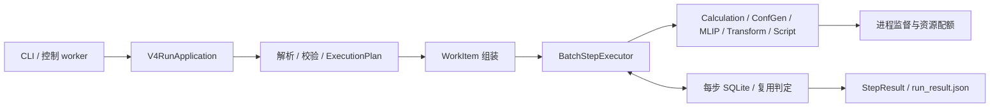

# ConfFlow 架构复审 · 2026-10-29

审查基线：`f5754b97e5b4d50535a9953f0da8387adedec661`，即 PR #196 已合并后的代码。当前源码的模块化分层、类型化数据和持久化框架可以继续使用；本轮确认 **3 项 P1、1 项 P2**，集中在跨执行器和跨状态的语义一致性。下面的 N1–N4 是本轮新编号，不代表重新打开上轮 R1–R8。

审查采用静态调用链检查、提交内容的独立快照测试，以及真实 SQLite / 原生进程监督配合假科学程序的最小复现。没有改动生产代码和仓内测试，也未运行真实 ORCA、Gaussian、xTB 或 UMA 模型。已有未跟踪实验文件未纳入提交基线测试。

**确认的问题**

| 编号 | 优先级 | 触发条件 | 已观察到的结果 |
| --- | --- | --- | --- |
| N1 | P1 | 已登记的 PENDING，或旧 owner 已死亡的 RUNNING，恢复时环境改变 | B 环境生成的结果仍登记为 A；切回 A 错误复用 B |
| N2 | P1 | ConfGen 配置裸名称 `xtb`，binding 的 PATH 与控制进程不同 | 校验、摘要使用 A，实际启动 B；修改 B 后仍复用 |
| N3 | P1 | 带显式拓扑的结构经过 MLIP | `topology_patch`、`working_topology` 丢失，下游重新感知出不同的键连接 |
| N4 | P2 | MLIP 产生能量并发布运行清单 | `run_result.json` 没有内联能量数值，只有结果引用和摘要 |

**N1：恢复分支没有推进执行环境身份**

位置：[reuse.py:297](/opt/ConfFlow/confflow/persistence/reuse.py:297)、[batch.py:852](/opt/ConfFlow/confflow/execution/batch.py:852)、[batch.py:621](/opt/ConfFlow/confflow/execution/batch.py:621)。

`evaluate_reuse()` 在检查摘要轴之前就为 PENDING 返回 `EXECUTE_NEW`、为已死亡 owner 的 RUNNING 返回 `RECOVER_ABANDONED`。批执行器捕获登记冲突后继续执行；恢复分支虽然会中断旧 attempt、创建新 attempt，却没有更新登记的环境摘要。本地结果提交返回的环境覆盖值通常为 `None`，所以登记仍指向旧环境。

复现使用真实 `SqliteWorkItemStore`、正式 `execute_step_resumable()`，仅将科学计算替换为记录实际环境的轻量执行器：

1. 以环境 A 的摘要登记任务；分别保留为 PENDING，或 claim 为不存在的 PID 所有的 RUNNING。
2. 以环境 B 恢复，计算执行成功，结果记录实际环境 B。
3. 数据库 `environment_digest` 仍等于 A，不等于 B。
4. 再以环境 A 执行，状态仍为 completed，实际执行列表只有 `["B"]`，返回的是 B 的结果。

RUNNING 案例保留两个 attempt；PENDING 案例只有一个 attempt。二者都出现错误复用。普通 COMPLETED 环境变更路径已有 `refresh_for_new_environment()`，缺口在上述提前返回的状态分支。

另做了完整应用入口验证：先通过正常工作流完成假 MLIP 模型 A 的计算，再使用公开 store 状态 API 构造同一模型下 owner 已死亡的 RUNNING（没有杀死真实控制进程）。假模型内容按 `-5 → -10 → -5` 改变，后续均通过 `V4RunApplication.run()` 恢复；三次都是 completed，返回能量却是 `-5 → -10 → -10`，登记摘要仍是最初模型 A 的摘要。恢复原模型后没有新增 attempt。这确认了缺口可影响正式应用路径的数值结果。

影响：修改程序、模型或科学环境后恢复一次中断的运行，会把新结果归入旧身份；重新使用旧环境时无法获得正确的重算行为。问题涉及通用批执行器，不限于 MLIP。

建议：在重新 claim 之前统一比较登记身份与本次身份；死亡 owner 的恢复先结束旧 attempt，再按正式的失效规则处理。只在允许的环境变更下推进登记，输入、定义或 producer provenance 变化仍按各自规则处理。不要仅在提交结果时补一个环境摘要，以免登记与 attempt 历史继续不一致。回归矩阵应覆盖 PENDING / RUNNING-dead / COMPLETED / FAILED / INTERRUPTED 与环境相同、环境变化的组合。

**N2：ConfGen 校验和启动了不同的 xTB**

位置：[v4_run.py:191](/opt/ConfFlow/confflow/application/v4_run.py:191)、[v4_run.py:978](/opt/ConfFlow/confflow/application/v4_run.py:978)、[confgen_search_run.py:834](/opt/ConfFlow/confflow/execution/confgen_search_run.py:834)、[confgen_search_worker.py:667](/opt/ConfFlow/confflow/execution/confgen_search_worker.py:667)。

应用层通过控制进程的 PATH 对 `binding.executable` 做身份测量和 allowlist 校验。随后 job 文件仍携带裸名称 `xtb`，worker 在 binding 的有效环境中再次调用 `shutil.which()`，因此解析到另一个文件。启动代码还重新读取了 `os.environ`，没有直接使用已经用于摘要的 `context.native_env` 快照。

通过正常 `V4RunApplication.run()` 复现：控制进程 PATH 优先指向 `a/xtb`，binding PATH 优先指向 `b/xtb`，`allowed_executables` 只允许 `a/xtb` 的绝对路径。两个文件都是独立的假 xTB 脚本。

- 首次运行 completed，实际 14 次 xTB 调用全部来自 `b/xtb`。
- 随后把 B 的能量表达式由 `-100.0 + …` 改为 `-200.0 + …`，保持配置和路径不变。
- 第二次运行仍 completed，调用次数仍为 14，没有启动新计算。

这同时证明执行策略没有约束实际启动的文件，以及实际科学程序的内容没有进入正确的复用身份。触发条件是正常支持的 PATH 覆盖，不依赖并发替换或恶意符号链接。

建议：先确定唯一的有效环境，在该环境下解析 xTB 的绝对路径，对同一个文件进行策略校验、内容测量，并把绝对路径放入 job。worker 使用同一环境快照，避免再次从裸名称和当前 ambient 环境做选择。补上“控制进程 PATH ≠ binding PATH”的端到端测试，分别断言拒绝未获准程序和实际二进制变化触发重算。

**N3：MLIP 输出丢失权威拓扑**

位置：[mlip_executor.py:738](/opt/ConfFlow/confflow/execution/mlip_executor.py:738)，下游行为见 [science/topology.py:114](/opt/ConfFlow/confflow/science/topology.py:114)。

MLIP 构造输出 `StructureRecord` 时复制了元素、坐标、科学参数、谱系及 metadata，却没有传递独立字段 `topology_patch`、`working_topology`。这些字段不等价于 metadata；遗漏后，下游 `resolve_working_adjacency()` 会重新按距离感知键。

两种入口均已复现：

- 直接执行器：输入水结构明确删除 1–3 键，权威邻接表为 `[[1], [0], []]`；单点计算后坐标完全相同，两个拓扑字段变为 `None`，下游邻接表变为 `[[1, 2], [0], [0]]`。邻接表采用零基索引。
- 正常工作流：在 `inputs.structures.topology.delete` 声明 `[[1, 3]]`，经应用层解析并运行 MLIP，仍 completed，输出同样丢失声明并恢复了该键。

影响：显式修正过的反应、断键或特殊连接结构经过 MLIP 后，会改变后续 ConfGen、refine、图同构和去重使用的科学语义；即使只是单点能量计算也会发生。

建议：让 MLIP 使用现有拓扑传播权威构建输出，并明确区分“预期工作图”和“松弛后按坐标观察到的键变化”。同时检查 `mlip_analysis.stretch_check()` 对权威输入图的使用。至少覆盖 sp、relax、sp_then_relax，以及仅有 patch、仅有 working graph、两者同时存在的合法输入。

**N4：MLIP 能量缺少来源，未被投影到公开清单**

位置：[mlip_executor.py:755](/opt/ConfFlow/confflow/execution/mlip_executor.py:755)、[producer/run_result.py:105](/opt/ConfFlow/confflow/producer/run_result.py:105)。

MLIP 产生的 `ScientificResult(kind="energy")` 没有 `ResultProvenance`。清单投影 `_energies_by_subject()` 要求来源至少含 program；缺少来源就跳过整个内联能量对象。`result_ref_entry()` 本身也不输出通用 `value`。

正常应用入口的最小运行得到 completed、内部能量 `-5.0 Hartree`。发布的 `run_result.json` 中 energy 条目有 `result_id`、`value_digest` 等字段，却没有 `energies` 和数值。只消费公开清单的客户端无法据此显示能量；完整结果和原始 JSONL 中仍保留数值，不是底层计算结果丢失。

建议：MLIP 构建完整的结果来源，包括程序、模型/任务及执行器版本等实际信息，再沿用已有清单投影。当前 schema 的 source.program 接受非空字符串，不需要为了容纳 MLIP 删除来源要求。用完整工作流断言清单中存在 `energies.electronic_hartree` 和真实 source，并覆盖 resume 后的投影。

**架构评估**

当前是模块化单体。主要路径是：



| 边界 | 本轮判断 |
| --- | --- |
| domain 与计划 | 不可变记录、明确输入输出端口和分离的摘要轴提供了良好的基础；继续保留统一语义来源 |
| 编译与执行 | 注册表统一入口已建立，但应用层仍需按 capability 手工拼装不同启动身份，ConfGen 与 MLIP 容易遗漏公共约束 |
| 执行与持久化 | claim、attempt、结果落盘、发布和 generation 仲裁均有明确结构；N1 表明“状态转移”和“身份转移”尚未被作为一个整体验证 |
| 科学输出与消费 | 原生 profile、MLIP 等独立组装结构/结果，拓扑与来源要求容易不一致；N3、N4 是可观察后果 |
| 控制协议与 worker | staging 的摘要校验、文件描述符与 no-follow 处理，以及控制库与计算库分离，是有价值的现有边界；本轮未确认新增阻断问题 |
| 测试与架构门禁 | 类型、静态依赖、契约及功能测试覆盖广；仍需增加执行器 × 输入语义、存储状态 × 身份变化的组合验证 |

源码规模是 199 个生产 Python 模块、70,551 物理行；V4 可达闭包为 181 模块、67,112 行。行数包括注释和空行。规模较大的关键文件包括 `science/confgen/explore.py`（2,181 行）、`execution/work_item_executor.py`（1,892 行）、`persistence/work_items.py`（1,616 行）、`execution/batch.py`（1,312 行）、`application/v4_run.py`（1,304 行）。这些数字用于标识审查集中点，本身不作为缺陷。

建议按以下顺序推进：先修 N1–N3，再补 N4；随后把公共启动身份和科学输出的必需字段收敛为受测试的协议。保持现有编译、执行、控制、持久化边界，逐步减少每新增一个执行器都需要复制的规则。同步更新 `docs/ARCHITECTURE.md`：能力列表和数据流尚未列出 MLIP，已经不能完整描述当前实现。

可落实为三个边界约束：

- **启动描述由一处确定。** 执行器声明所需程序和额外科学依赖，应用层在有效环境下完成路径解析、策略校验和身份测量，把冻结的路径、环境和身份传给执行器。启动端不重新选择二进制或重新拼接 ambient 环境。
- **恢复同时处理状态和身份。** 将新 attempt 所属的环境、输入、定义和 producer 版本与 claim 一起验证，不能只凭 PENDING / owner-dead 状态就启动。保存旧 attempt 的身份，以便审计恢复前后使用了什么。
- **科学输出有共同的最低契约。** 对结构明确规定拓扑、谱系和身份如何继承，对数值结果规定来源如何提供；用同一组契约用例检查各执行器及公开清单，保留不同科学算法自己的实现。

**与上轮结论的关系**

PR #196 的根目录预检、计划中各步骤数据库预检，以及数据库/侧文件符号链接拒绝逻辑均已进入本轮基线。调用顺序是根预检在建目录前、步骤预检在 `begin_generation` 前；没有将上述已修复问题重新计入本轮发现。DELETE 批准仍只由底层 API 暴露，正常工作流拒绝非本地或无法确认的存储这一行为不变。

R8 的根包惰性可用性检测与入口日志初始化已纳入基线。R6 继续维持测量后的暂缓结论；本轮没有重新做真实性能基准，也没有把既有测量推广到大型工作流或真实量化程序。

**验证与复现材料**

- 在 `git archive HEAD` 的独立目录、Python 3.12.3 下运行 `pytest tests -q -o addopts=''`：**4971 passed、10 skipped，耗时 1164.75 秒（19 分 24 秒）**。已有未跟踪实验文件未进入此测试集合。[完整测试日志](data/architecture-review-20261029/pytest.txt)。
- `ruff check .`：通过。
- `mypy confflow`：199 个源文件通过。
- `scripts/v4_arch_scan.py`：42 个入口文件通过；该数字是此扫描器的范围，不代表只审查了 42 个模块。
- 七个最小场景已执行：RUNNING 恢复、PENDING 恢复、完整应用中的模型变更与崩溃恢复、ConfGen PATH 与二进制替换、MLIP 直接拓扑传播、MLIP 正常工作流拓扑传播、MLIP 清单能量投影。

全量现有测试通过，七个新增观察场景仍复现上述缺口；通过数量不替代这些跨模块语义的验证。本轮未测量覆盖率，也未重新运行多 Python 版本的 CI。

观察型复现脚本：[reproduce.py](data/architecture-review-20261029/reproduce.py)；原始观测：[results.json](data/architecture-review-20261029/results.json)。脚本中的科学程序来自提交内的假运行器；运行产物写入新建的 `/tmp/confflow-review-cases-20261029.*`。脚本打印实际结果，不把退出码 0 当作项目语义正确的断言。

在本审查提交对应的仓库根目录可执行：

```bash
PYTHONPATH="$PWD" .venv/bin/python docs/reviews/data/architecture-review-20261029/reproduce.py
```

本轮是源码架构和软件行为审查，不验证真实 UMA 模型的科学精度、量化程序数值正确性或集群吞吐能力。
